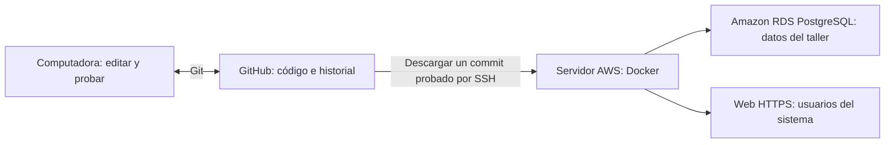

# Guía para recibir, editar y publicar Control Taller

Esta guía describe el flujo confirmado por la responsable del proyecto:
**editar en una computadora, subir el código a GitHub y actualizar producción
entrando por SSH a un servidor AWS que ejecuta Docker**. No presupone que se
publique automáticamente al hacer `git push`.

Repositorio: <https://github.com/miliihartwich/control-taller-actualizado>.
El código configura el dominio `app.hartwich.com.uy`. El documento de despliegue
indica producción en Ohio (`us-east-2`) y staging en Virginia (`us-east-1`);
hay que confirmar estos datos contra el servidor real.

El documento aportado `Comandos EC2 y base de datos ACTUALIZADO 3.3.26.docx`
registra PowerShell → WSL → SSH a EC2 Ohio con usuario `ec2-user`, Docker con
`sudo` y PostgreSQL en **Amazon RDS**, con base `controltaller`, usuario
`postgres`, puerto `5432` y `sslmode=require`. Sus datos concretos de IP, clave
y endpoint se guardaron en una ficha local privada; no se publican en esta guía.
Ese documento no incluye la carpeta del proyecto ni el comando de despliegue:
todavía hay que completarlos mediante el inventario de la sección 8.

Los ejemplos de la computadora local usan **PowerShell en Windows**. Los del
servidor usan **Bash en Linux**. Los nombres en MAYÚSCULAS que indican
`COMPLETAR` o `PEGAR` deben sustituirse antes de ejecutar el bloque.

## 1. Qué guarda cada parte



- GitHub guarda fuentes, imágenes del frontend, dependencias y configuración pública.
- La computadora de desarrollo usa una base de prueba propia.
- EC2 ejecuta los contenedores y se conecta a la base real en RDS, según el
  documento de referencia. Confirmar esa conexión efectiva antes de publicar.
- Las contraseñas, los `.env`, las claves SSH, los certificados y los respaldos
  se entregan por un canal privado y se conservan fuera de Git.

Para usar el sistema como usuario alcanza con abrir su web. Para modificarlo
hay que preparar el entorno de desarrollo de las secciones siguientes.

## 2. Entrega inicial: completar antes de trabajar

La responsable actual debe entregar lo siguiente:

1. **Acceso a GitHub con la cuenta propia del hermano.** En el repositorio,
   abrir `Settings > Collaborators > Add people` y enviarle una invitación.
   Él debe aceptarla. [Instrucciones oficiales](https://docs.github.com/en/repositories/managing-your-repositorys-settings-and-features/repository-access-and-collaboration/inviting-collaborators-to-a-personal-repository).
2. **Acceso SSH al servidor.** Registrar host, usuario, puerto y forma de acceso.
   Puede habilitarse una clave personal del hermano en el servidor o transferirse
   el acceso existente por el canal privado acordado. Nunca subir una `.pem` a GitHub.
3. **Configuración real de producción.** Ubicación de los `.env`, conexión a la
   DB, proyecto Docker, certificados, tareas programadas y respaldos.
4. **Base de prueba utilizable.** Un archivo privado `controltaller-dev.dump`
   en formato PostgreSQL custom, preparado con datos de prueba y el esquema real.
   Debe ser compatible con PostgreSQL 15, la versión del Compose local, e incluir
   catálogos, configuraciones, relaciones y una cuenta de prueba
   con su empleado asociado y rol `admin` o `propietario`.
5. **Ficha del servidor.** Completar una copia privada de
   [FICHA_DEL_SERVIDOR.example.md](FICHA_DEL_SERVIDOR.example.md).

Actualmente el repo **no contiene migraciones, un esquema SQL ni datos iniciales**.
Una DB nueva arrancará vacía. El dump de prueba es un requisito real de la
entrega; levantar Docker y obtener `200` en `/health` no lo reemplaza. La copia
de desarrollo debe prepararse sin los datos personales ni las contraseñas reales
del taller. Si todavía no existe, la responsable debe prepararla antes de dar
por terminada la instalación local.

## 3. Preparar la computadora

Instalar Git, un editor como VS Code y Docker Desktop con contenedores Linux.
Abrir Docker Desktop y esperar que el motor esté funcionando. Docker ejecuta
Python y Node dentro de los contenedores; no hace falta instalarlos en Windows
para seguir este flujo.

En PowerShell:

```powershell
git --version
docker version
docker compose version
git clone https://github.com/miliihartwich/control-taller-actualizado.git
Set-Location control-taller-actualizado
git config user.name "Nombre del hermano"
git config user.email "CORREO_DE_SU_CUENTA_GITHUB"
git status
```

Para repos privados y para subir cambios, Git puede pedir inicio de sesión en
GitHub. Usar la cuenta propia que recibió acceso. Abrir esta carpeta en VS Code.

Si también se trabaja fuera de Docker, los Dockerfiles usan Python 3.11 y
Node 20. Usar Node 20.19 o posterior dentro de la rama 20 si se instala fuera de
Docker. La instalación limpia del frontend se verificó con Node 20.19.0.
En PowerShell, usar `npm.cmd` si una política de ejecución bloquea `npm.ps1`.

## 4. Crear la configuración local

Estos comandos son para el **primer clon**, cuando los `.env` aún no existen:

```powershell
Copy-Item .env.example .env
Copy-Item backend/.env.example backend/.env
```

Editar `.env` y sustituir sus contraseñas de ejemplo por una contraseña local.
Usar la misma en `POSTGRES_PASSWORD`, `PGPASSWORD` y en el componente de contraseña
de `DATABASE_URL` dentro de `backend/.env`. Una contraseña aleatoria alfanumérica
evita problemas de codificación del URL; símbolos como `@`, `:` o `/` necesitan
codificación URL cuando aparecen dentro de la contraseña del URL.

Para generar un valor aleatorio sin instalar Python en Windows:

```powershell
docker run --rm python:3.11-slim python -c "import secrets; print(secrets.token_hex(32))"
```

Usar un valor para la contraseña de DB local y otro para `JWT_SECRET_KEY`.
Guardar los valores únicamente en los `.env` locales.

`backend/.env` local debe quedar con estos valores y secretos propios de prueba:

```dotenv
APP_ENV=local
DATABASE_URL=postgresql://milagros:CONTRASENA_LOCAL@db:5432/controltaller
PGSSLMODE=disable
JWT_SECRET_KEY=CLAVE_ALEATORIA_SOLO_LOCAL
DEV_NO_AUTH=0
FRONT_ORIGIN=http://localhost:5174
JWT_COOKIE_SECURE=False
JWT_COOKIE_SAMESITE=Lax
```

`db` es el nombre del servicio PostgreSQL dentro de la red Docker. El dominio
de producción y sus credenciales no se usan para probar en esta computadora.
Conservar los archivos existentes en los usos posteriores; volver a copiar los
ejemplos encima de un `.env` borraría su configuración.

El flujo local utiliza `docker-compose.yml` con el perfil `dev`.
`docker-compose.dev.yml` es otro archivo que levanta solamente una DB distinta
en el puerto 55432; no se combina como override en estas instrucciones.

## 5. Importar la base de prueba y arrancar

Los comandos de esta sección se ejecutan **en la computadora local**, desde la
raíz del proyecto, y la importación corresponde a una DB nueva y vacía.

```powershell
docker compose --profile dev up -d db
docker compose exec db pg_isready -U milagros -d controltaller
```

Esperar a que PostgreSQL indique que acepta conexiones. Después copiar el dump
privado a su contenedor e importarlo:

```powershell
$devDump = "C:\RESPALDOS-PRIVADOS\controltaller-dev.dump"
docker compose cp "$devDump" db:/tmp/controltaller-dev.dump
if ($LASTEXITCODE -ne 0) { throw "No se pudo copiar la base de prueba" }
docker compose exec db pg_restore --username=milagros --dbname=controltaller --no-owner --no-privileges --exit-on-error /tmp/controltaller-dev.dump
if ($LASTEXITCODE -ne 0) { throw "La importacion fallo: revisar antes de seguir" }
docker compose --profile dev up -d --build
docker compose --profile dev ps
```

Importar una sola vez. Si hay errores porque ya existen tablas, revisar el estado
de esa DB; no agregar `--clean` para borrar datos sin entender el problema.

Abrir <http://localhost:5174/login> y entrar con la cuenta de prueba entregada.
Comprobar las pantallas de órdenes, clientes, intervenciones y clasificaciones.

Comprobaciones locales:

```powershell
Invoke-RestMethod http://localhost:5174/api/health
Invoke-RestMethod http://localhost:5174/api/divisiones_id
docker compose --profile dev logs --tail 100 backend frontend_dev
docker compose exec db psql -U milagros -d controltaller -c "\dt"
```

`/health` verifica que Flask responde. `/divisiones_id` consulta una tabla real:
debe responder sin errores SQL. El ingreso y las pantallas verifican además los
datos iniciales. Para detener el entorno conservando la base:

```powershell
docker compose --profile dev stop
```

## 6. Dónde editar y cómo aplicar un cambio

| Cambio | Archivos principales |
| --- | --- |
| Divisiones, tipos y descripciones de órdenes | `backend/routes/clasificacion_ordenes_routes.py` |
| Formulario y listado de clasificaciones | `frontend/src/components/ClasificacionOrdenesForm.vue`, `VerClasificacionOrdenes.vue` |
| Otras operaciones del backend | `backend/routes/*.py` |
| Registrar un blueprint nuevo | `backend/routes/__init__.py` |
| Pantallas y formularios | `frontend/src/components/*.vue` |
| Navegación y permisos visuales | `frontend/src/router.js` |
| Llamadas a la API y cookies | `frontend/src/api.js` |
| Login y configuración JWT | `backend/routes/auth_routes.py`, `backend/app.py` |
| Conexión a PostgreSQL y SSL | `backend/db.py` |
| Proxy de desarrollo | `frontend/vite.config.js` |
| Proxy HTTPS y certificados de producción | `frontend/nginx.conf` |
| Contenedores, puertos y volumen PostgreSQL | `docker-compose.yml` |
| Versiones de dependencias | `frontend/package.json`, `frontend/package-lock.json`, `backend/requirements.txt` |

Las llamadas del navegador salen como `/api/...`. Vite en desarrollo y Nginx en
producción quitan `/api` y envían al backend. Flask registra rutas como
`/auth/login` y `/divisiones_id`; no agregar otro `/api` en las rutas Flask.

Los cambios en `.vue` se recargan con Vite. Gunicorn no usa recarga automática;
después de editar Python:

```powershell
docker compose restart backend
```

Después de modificar `backend/.env`, hay que recrear el backend para que vuelva
a leer `env_file`:

```powershell
docker compose up -d --no-deps --force-recreate backend
```

Al cambiar dependencias Python o su Dockerfile:

```powershell
docker compose up -d --no-deps --build backend
```

Al cambiar dependencias del frontend, actualizar y guardar el lockfile, y
reconstruir renovando su volumen anónimo de `node_modules`:

```powershell
docker compose exec frontend_dev npm install NOMBRE_DEL_PAQUETE
```

Sustituir por el paquete requerido; agregar `--save-dev` si es una herramienta
de desarrollo. Este comando actualiza `package.json` y `package-lock.json` en la
carpeta compartida. Después:

```powershell
docker compose --profile dev up -d --no-deps --build --renew-anon-volumes frontend_dev
```

Este último comando actúa sobre `frontend_dev`; no borra el volumen nombrado de DB.

## 7. Probar, guardar y compartir los cambios

Antes de empezar una tarea nueva, con los cambios anteriores ya guardados:

```powershell
git switch main
git pull --ff-only
git switch -c mejora/nombre-del-cambio
```

Editar y probar en la base local. Como mínimo:

```powershell
docker compose exec backend python -m compileall -q .
docker compose exec frontend_dev npm run build
git diff --check
git status --short
git diff
```

Probar el caso modificado con datos de prueba y verificar ingreso, listado de
órdenes y clasificaciones. El repo no incluye una suite de tests automatizados;
compilar no demuestra que las consultas SQL o una pantalla funcionen.

Agregar los archivos que corresponden al cambio, revisar y guardar:

```powershell
git add backend/routes/ARCHIVO_MODIFICADO.py frontend/src/components/COMPONENTE_MODIFICADO.vue
git diff --cached
git commit -m "Explicar que cambia y para que"
git push -u origin mejora/nombre-del-cambio
```

Los nombres del `git add` son ejemplos: sustituirlos por los archivos realmente
modificados, incluyendo lockfiles si cambiaron dependencias. No agregar `.env`,
claves SSH, dumps ni archivos de datos reales.

En GitHub, abrir una **Pull Request hacia `main`**, describir el cambio y las
pruebas, revisar y hacer merge. Después obtener el commit final que se desplegará:

```powershell
git switch main
git pull --ff-only
git rev-parse HEAD
```

Guardar ese SHA completo. Si el merge incorporó cambios nuevos, repetir las
pruebas necesarias sobre ese commit. La publicación debe usar el commit probado,
no simplemente lo último que aparezca en `main` mientras se está desplegando.

## 8. Conectar e identificar producción una vez

Desde la computadora del hermano:

```powershell
ssh -i "C:\CLAVES-PRIVADAS\CLAVE_DEL_SERVIDOR.pem" USUARIO_SSH@SERVIDOR
```

Sustituir por los datos reales de la ficha; si existe un puerto especial, bastión
o VPN, utilizar el mismo método actual. En Linux/macOS, una `.pem` necesita
permisos privados como `chmod 400 CLAVE_DEL_SERVIDOR.pem`.
[Requisitos de conexión SSH en AWS](https://docs.aws.amazon.com/AWSEC2/latest/UserGuide/connection-prereqs-general.html).

El procedimiento registrado utiliza WSL. Para seguirlo, abrir primero desde
PowerShell una distribución WSL ya instalada:

```powershell
wsl
```

Después, dentro de WSL, con la clave privada disponible en su carpeta `.ssh`:

```bash
chmod 400 ~/.ssh/CLAVE_DEL_SERVIDOR.pem
ssh -i ~/.ssh/CLAVE_DEL_SERVIDOR.pem ec2-user@SERVIDOR
```

Usar la IP y el nombre real de la clave de la ficha privada. La ruta de WSL es
una ruta Linux, diferente de `C:\...`. Si SSH da timeout, comprobar con la
responsable de AWS que la EC2 está `Running` y que la regla de acceso SSH permite
la IP actual de la computadora del hermano, como recuerda el documento.
[Comandos básicos de WSL](https://learn.microsoft.com/en-us/windows/wsl/basic-commands).

En el servidor, ejecutar solamente este inventario antes de modificar la instalación:

```bash
pwd
sudo docker version
sudo docker compose version
sudo docker ps --format '{{.Names}}\t{{.Image}}\t{{.Status}}'
sudo docker inspect -f '{{index .Config.Labels "com.docker.compose.project"}}' backend_controltaller
sudo docker inspect -f '{{index .Config.Labels "com.docker.compose.project.working_dir"}}' backend_controltaller
sudo docker inspect -f '{{index .Config.Labels "com.docker.compose.project.config_files"}}' backend_controltaller
sudo docker inspect -f '{{range .NetworkSettings.Networks}}{{.NetworkID}} {{end}}' backend_controltaller
sudo docker inspect -f '{{range $name, $value := .NetworkSettings.Networks}}{{$name}} {{end}}' backend_controltaller
sudo docker inspect -f '{{range .Mounts}}{{printf "%s -> %s (%s)\n" .Source .Destination .Type}}{{end}}' backend_controltaller
sudo docker exec backend_controltaller python -c 'import db; from urllib.parse import urlsplit; u=urlsplit(db.DATABASE_URL); print("host_db=",u.hostname,"base=",u.path.lstrip("/"),"sslmode=",db.sslmode)'
```

Estos nombres de contenedores son los del repo. Si `docker ps` muestra otros,
usar los nombres reales. Registrar también el comando original de despliegue,
todos sus archivos `-f`, el volumen de DB y la red que utiliza el backend.

Solo si existe una DB Docker con ese nombre, registrar también sus datos:

```bash
if sudo docker inspect postgres_controltaller > /dev/null 2>&1; then
  sudo docker inspect -f '{{index .Config.Labels "com.docker.compose.project"}}' postgres_controltaller
  sudo docker inspect -f '{{range .Mounts}}{{printf "%s -> %s (%s)\n" .Source .Destination .Type}}{{end}}' postgres_controltaller
fi
```

El `DATABASE_URL` efectivo indica si se usa la DB Docker o una base externa.
La existencia de un contenedor `db` no demuestra que producción lo use.

El documento también muestra `sudo docker exec -it backend_controltaller sh`
para entrar al contenedor. Esa terminal está **dentro del contenedor**; usar
`exit` para volver al host EC2 antes de ejecutar los comandos de despliegue.
Los comandos Compose y las carpetas de releases pertenecen al host.

### Consultar RDS cuando haga falta

El `psql` del documento requiere un cliente PostgreSQL disponible. El Dockerfile
actual del backend instala la biblioteca `libpq-dev`, pero no instala el comando
`psql`; no suponer que está presente dentro del backend.

Después de registrar la red real en `RED_DOCKER`, consultar la versión del servidor
y utilizar un contenedor cliente. Sustituir `ENDPOINT_RDS_DE_LA_FICHA` antes de ejecutar:

```bash
RED_DOCKER="PEGAR_NOMBRE_RED_DEL_BACKEND_DEL_INVENTARIO"
PG_MAJOR="$(sudo docker exec backend_controltaller python -c 'from db import get_db_connection; c=get_db_connection(); print(c.server_version // 10000); c.close()')"
sudo docker run --rm -it --network "$RED_DOCKER" "postgres:$PG_MAJOR" \
  psql --password "host=ENDPOINT_RDS_DE_LA_FICHA port=5432 dbname=controltaller user=postgres sslmode=require"
```

PostgreSQL solicita la contraseña aparte. Entregarla por el canal privado y no
ponerla en el comando ni en GitHub. Para salir de `psql` usar `\q`.
Entrar a la consola no es un paso obligatorio de cada despliegue ni una indicación
de modificar la DB. [Conectar a RDS usando psql](https://docs.aws.amazon.com/AmazonRDS/latest/UserGuide/USER_ConnectToPostgreSQLInstance.psql.html).

Si el servidor tiene otro proxy, nombres distintos, overrides o redes explícitas,
adaptar la configuración nueva antes de ejecutar la sección 11. La guía no
autoriza asumir que la instalación real coincide sin revisarla.

## 9. Primera adopción del repositorio nuevo

El repositorio publicado en octubre de 2026 empezó con un commit raíz que conserva
el código actual y excluye archivos grandes y secretos históricos. El historial
anterior quedó respaldado en la computadora original, en la rama local
`respaldo/antes-de-github-20261009`, y no se publicó en GitHub.

Por eso el checkout antiguo del servidor puede tener un historial diferente.
**Conservar intacta esa carpeta** y usar una carpeta nueva por release evita
forzar un merge/reset sobre el código que está funcionando.

Además, el backend monta `./backend:/app`: sus fuentes se leen de la carpeta
del servidor. Editar o hacer checkout dentro de la carpeta activa puede modificar
el servicio antes de recrear el contenedor. Las releases separadas también
resuelven ese problema.

Definir los datos reales de la ficha. Estos valores se reutilizan en los bloques
siguientes de la misma sesión SSH:

```bash
set -e
umask 077
OPERACION="$HOME/control-taller-operacion"
PROYECTO_DOCKER="COMPLETAR_PROYECTO_COMPOSE_ORIGINAL"
DIRECTORIO_ANTERIOR="/COMPLETAR/RUTA/ORIGINAL"
export RED_DOCKER="COMPLETAR_RED_DOCKER_DEL_BACKEND"
REPO="https://github.com/miliihartwich/control-taller-actualizado.git"
mkdir -p "$OPERACION/shared" "$OPERACION/releases" "$OPERACION/backups"
```

El proyecto Compose debe ser **el original**, no el nombre de la nueva carpeta.
Compose utiliza ese nombre para identificar servicios, redes y volúmenes.
[Nombre de proyecto Compose](https://docs.docker.com/reference/cli/docker/compose/).

El documento utiliza `sudo docker`; los ejemplos de servidor lo incluyen.
`sudo` suele limpiar variables de la sesión, por eso la función `dc` y el comando
de recuperación legacy pasan explícitamente `RELEASE_ID` y `RED_DOCKER` mediante
`sudo env`. Son metadatos de la release, no contraseñas. No cambiar los permisos
del servidor como parte de una publicación ordinaria.

Si el servidor usa una deploy key SSH de GitHub para un repo privado, cambiar
el URL antes de clonar:

```bash
REPO="git@github.com:miliihartwich/control-taller-actualizado.git"
```

Ese acceso SSH de GitHub debe estar habilitado en el servidor. La clave para
entrar al servidor AWS y la deploy key para descargar GitHub son accesos distintos.

Copiar la configuración privada real a `shared`; no usar ejemplos locales para producción:

```bash
cp "$DIRECTORIO_ANTERIOR/backend/.env" "$OPERACION/shared/backend.env"
```

Si el `.env` del backend está en otra ruta, copiar el archivo real que usa el
despliegue. Guardar también el `.env` original de la raíz como
`$OPERACION/shared/.env`, si existe:

```bash
cp "$DIRECTORIO_ANTERIOR/.env" "$OPERACION/shared/.env"
```

Ejecutar esa copia solo si el archivo original existe. Si falta, crearlo con
`nano "$OPERACION/shared/.env"`. El Compose del repo necesita un valor no vacío
para `POSTGRES_PASSWORD`, incluso cuando solamente se publican los servicios de
aplicación y la DB real está en RDS. Para ese caso puede registrarse
`POSTGRES_PASSWORD=VALOR_LOCAL_NO_USADO_POR_RDS`: ese valor corresponde al servicio
local `db` que no se arranca en producción mediante este flujo. **La contraseña
RDS está en el `DATABASE_URL` real del backend y se conserva sin cambiarla.**

Si el inventario descubre que la aplicación usa una DB Docker en vez de RDS,
conservar la contraseña actual de esa DB en `POSTGRES_PASSWORD`. Cambiarla en
un `.env` no cambia automáticamente la contraseña de un volumen inicializado.

Comprobar en `shared/backend.env` los valores de producción:

| Variable | Valor a conservar o confirmar |
| --- | --- |
| `DATABASE_URL` | Mismo endpoint RDS real y mismas credenciales que usa el sistema actual; no sustituirlo por `db` |
| `JWT_SECRET_KEY` | Conservar la clave de producción; no generar una por release |
| `DEV_NO_AUTH` | `0` |
| `APP_ENV` | `production` al validar la configuración completa |
| `FRONT_ORIGIN` | `https://app.hartwich.com.uy`, si ese es el dominio activo |
| `JWT_COOKIE_SECURE` | `True` para HTTPS |
| `JWT_COOKIE_SAMESITE` | Conservar el valor probado, normalmente `Lax` con el mismo origen |
| `PGSSLMODE` | `require` para la conexión RDS documentada; confirmar el valor efectivo |

`backend/db.py` pide SSL por defecto cuando `APP_ENV=production`. La conexión RDS
documentada utiliza `require`: conservarlo. `PGSSLMODE=disable` del ejemplo de
desarrollo es para PostgreSQL Docker local sin TLS; no trasladarlo a producción
RDS. [SSL en RDS PostgreSQL](https://docs.aws.amazon.com/AmazonRDS/latest/UserGuide/PostgreSQL.Concepts.General.SSL.html).

Antes de construir imágenes nuevas, preservar las dos imágenes actuales:

```bash
LEGACY_ID="legacy-$(date -u +%Y%m%dT%H%M%SZ)"
sudo docker image tag "$(sudo docker inspect -f '{{.Image}}' backend_controltaller)" "control-taller/backend:$LEGACY_ID"
sudo docker image tag "$(sudo docker inspect -f '{{.Image}}' frontend_controltaller)" "control-taller/frontend:$LEGACY_ID"
printf '%s\n' "$LEGACY_ID" > "$OPERACION/shared/legacy-release.txt"
```

Conservar el directorio anterior, sus `.env`, sus archivos Compose y el comando
original. Revisar cron/timers: una tarea que apunta a esa carpeta deberá pasar
a la release activa con el mismo comportamiento antes de completar el traspaso.
Los certificados existentes de `/etc/letsencrypt` permanecen en el host; no se
copian al repositorio ni se regeneran por cada publicación.

Crear un override privado que reutilice explícitamente la red existente en lugar
de crear una red nueva. Comprobar primero que la red registrada es la utilizada
por el backend y la DB si esta última está en Docker:

```bash
sudo docker network inspect "$RED_DOCKER" --format '{{range .Containers}}{{.Name}} {{end}}'
cat > "$OPERACION/shared/compose.server.yml" <<'YAML'
networks:
  default:
    external: true
    name: ${RED_DOCKER:?Define RED_DOCKER con la red existente}
YAML
```

Este ejemplo corresponde a los servicios del Compose del repo, que utilizan la
red `default`. Si la instalación real usa varias redes u otros overrides,
incorporar sus ajustes en este archivo privado y conservarlos en cada release.
El nombre de proyecto conserva los nombres predeterminados; el override conserva
también una red que tenga un nombre explícito distinto.
[Redes externas de Compose](https://docs.docker.com/compose/how-tos/networking/).

## 10. Respaldar la DB real antes de publicar

En la arquitectura indicada por el documento, el respaldo debe ser de **RDS**.
No usar `docker compose exec db pg_dump` como respaldo de producción: ese
servicio puede ser una DB local distinta. El bloque de esta sección utiliza la
conexión efectiva del backend para respaldar la DB correcta.

Este procedimiento descarga la conexión efectiva del backend a un archivo
privado sin mostrarla en la terminal y utiliza un cliente PostgreSQL de la misma
versión mayor. Sirve tanto para la DB Docker como para una DB externa accesible
desde la red del backend. Si el respaldo falla, corregirlo antes de publicar.

```bash
PG_MAJOR="$(sudo docker exec backend_controltaller python -c 'from db import get_db_connection; c=get_db_connection(); print(c.server_version // 10000); c.close()')"
sudo docker exec backend_controltaller python -c 'import db; from psycopg2.extensions import make_dsn; print("DATABASE_URL=" + make_dsn(db.DATABASE_URL, sslmode=db.sslmode)); print("PGSSLMODE=" + db.sslmode)' > "$OPERACION/shared/pg-backup.env"
RESPALDO="$OPERACION/backups/controltaller-$(date -u +%Y%m%dT%H%M%SZ).dump"
sudo docker run --rm --network "$RED_DOCKER" --env-file "$OPERACION/shared/pg-backup.env" "postgres:$PG_MAJOR" sh -c 'exec pg_dump --format=custom --dbname="$DATABASE_URL"' > "$RESPALDO"
test -s "$RESPALDO"
sudo docker run --rm --network none --mount "type=bind,source=$RESPALDO,target=/backup.dump,readonly" "postgres:$PG_MAJOR" pg_restore --list /backup.dump > "$RESPALDO.listado.txt"
```

`pg_restore --list` comprueba que el archivo tiene un formato legible; la
recuperación debe probarse periódicamente sobre una DB separada. Conservar una
copia privada fuera de esta instancia según el procedimiento de respaldo del
taller. [Formato de respaldo PostgreSQL](https://www.postgresql.org/docs/15/app-pgdump.html).

Si la DB requiere certificados cliente o comprobación `verify-ca`/`verify-full`,
el contenedor del cliente de respaldo también debe disponer de los certificados
y rutas registrados en la ficha. Montarlos según esa configuración o utilizar
el procedimiento de respaldo existente ya validado; comprobar el resultado
antes de continuar.

No convertir ese respaldo completo de producción en la base de desarrollo sin
preparar antes una copia con datos de prueba y credenciales distintas.

## 11. Publicar un commit probado en producción

Esta sección supone que el inventario y la primera adopción están completos.
El proyecto Docker, los servicios y la red deben coincidir con los de producción.
En cada nueva sesión SSH, definir las variables de la sección 9 con sus valores
reales. Acordar un momento de mantenimiento: recrear los servicios puede producir
una interrupción breve.

### 11.1 Descargar una release sin alterar la que está funcionando

```bash
COMMIT_A_PUBLICAR="PEGAR_SHA_COMPLETO_PROBADO_DE_GITHUB"
RUTA_RELEASE="$OPERACION/releases/$COMMIT_A_PUBLICAR"
test ! -e "$RUTA_RELEASE"
git clone --no-checkout "$REPO" "$RUTA_RELEASE"
git -C "$RUTA_RELEASE" checkout --detach "$COMMIT_A_PUBLICAR"
test "$(git -C "$RUTA_RELEASE" rev-parse HEAD)" = "$COMMIT_A_PUBLICAR"
cp "$OPERACION/shared/.env" "$RUTA_RELEASE/.env"
cp "$OPERACION/shared/backend.env" "$RUTA_RELEASE/backend/.env"
export RELEASE_ID="$COMMIT_A_PUBLICAR"
```

Si la ruta ya existe por un intento anterior, comprobar su commit y estado y
reutilizarla solo si corresponde; no borrarla automáticamente. Si el repo es
privado, el servidor necesita un acceso a GitHub ya habilitado, por ejemplo una
deploy key de solo lectura. No escribir tokens dentro del URL del repositorio.

`docker-compose.release.yml` añade etiquetas de imagen por commit. Se usa
explícitamente junto con el Compose base y no altera el arranque local habitual.

### 11.2 Validar y construir antes del cambio

Definir esta función en la sesión actual para utilizar siempre los mismos archivos:

```bash
dc() {
  sudo env RELEASE_ID="$RELEASE_ID" RED_DOCKER="$RED_DOCKER" docker compose --env-file "$RUTA_RELEASE/.env" -p "$PROYECTO_DOCKER" \
    -f "$RUTA_RELEASE/docker-compose.yml" \
    -f "$RUTA_RELEASE/docker-compose.release.yml" \
    -f "$OPERACION/shared/compose.server.yml" \
    --profile prod "$@"
}
dc config --quiet
dc build backend frontend
```

`config --quiet` valida la configuración sin imprimir las credenciales resueltas.
Construir las imágenes todavía no cambia los contenedores activos. Si hay otros
overrides de producción, integrarlos y conservar la red, los mounts y demás
ajustes confirmados en la ficha antes de continuar.

### 11.3 Cambiar únicamente los dos servicios de aplicación

```bash
dc up -d --no-deps --no-build --force-recreate backend frontend
dc ps
dc logs --tail 100 backend frontend
```

`--no-deps` mantiene la DB existente. Se recrean backend y frontend juntos para
que Nginx resuelva la dirección actual del backend. La publicación no utiliza
`down`, `--remove-orphans` ni recrea el servicio `db`.
[Comportamiento de `docker compose up`](https://docs.docker.com/reference/cli/docker/compose/up/).

### 11.4 Comprobar antes de declarar publicada la versión

```bash
curl --fail --show-error https://app.hartwich.com.uy/api/health
dc exec -T backend python -c 'from db import get_db_connection; c=get_db_connection(); q=c.cursor(); q.execute("SELECT 1"); print(q.fetchone()); q.close(); c.close()'
sudo docker inspect -f '{{.Config.Image}}' backend_controltaller
sudo docker inspect -f '{{.Config.Image}}' frontend_controltaller
```

El HTTP debe responder y la consulta debe mostrar `(1,)`. Las imágenes deben
corresponder al SHA publicado. Abrir la web, ingresar con una cuenta autorizada,
revisar las órdenes existentes y probar el comportamiento cambiado sin crear
datos ficticios en la base real. Comprobar además tareas programadas y logs.

Registrar la release anterior y la actual en una ficha privada. Después de una
publicación correcta:

```bash
printf '%s\n' "$COMMIT_A_PUBLICAR" > "$OPERACION/shared/commit-publicado.txt"
```

Conservar releases e imágenes anteriores suficientes para volver atrás.

## 12. Volver a la versión anterior si algo falla

### Luego de la adopción: volver a una release conocida

Usar el SHA anterior registrado y la carpeta anterior intacta:

Si el error cerró la sesión SSH, volver a entrar, definir las variables de la
sección 9 y volver a definir la función `dc` de la sección 11.2 antes de ejecutar
los comandos de recuperación. No ejecutar sus comandos `build` para un rollback.

```bash
COMMIT_ANTERIOR="PEGAR_SHA_DE_LA_RELEASE_QUE_FUNCIONABA"
RUTA_RELEASE="$OPERACION/releases/$COMMIT_ANTERIOR"
export RELEASE_ID="$COMMIT_ANTERIOR"
test -f "$RUTA_RELEASE/docker-compose.release.yml"
sudo docker image inspect "control-taller/backend:$RELEASE_ID" > /dev/null
sudo docker image inspect "control-taller/frontend:$RELEASE_ID" > /dev/null
dc config --quiet
dc up -d --no-deps --no-build --force-recreate backend frontend
```

La función `dc` usa la nueva `RUTA_RELEASE`; repetir los controles HTTP, SQL e
ingreso de la sección 11.4 y actualizar la ficha de la versión que quedó activa.
Así vuelven tanto las imágenes como las fuentes del bind mount y los `.env` de
esa release. Volver solo a una imagen no alcanzaría con el bind mount del backend.

Después de comprobar que la versión anterior funciona, actualizar el registro:

```bash
printf '%s\n' "$COMMIT_ANTERIOR" > "$OPERACION/shared/commit-publicado.txt"
```

### Si falla la primera adopción: recuperar la instalación original

Conservar la ruta de la release nueva para acceder al override de imágenes:

Si hubo que reconectar por SSH, volver a definir las variables de la sección 9
y `RUTA_RELEASE` con la carpeta nueva creada en la sección 11.1.

```bash
ARCHIVO_IMAGENES_RELEASE="$RUTA_RELEASE/docker-compose.release.yml"
export RELEASE_ID="$(cat "$OPERACION/shared/legacy-release.txt")"
sudo env RELEASE_ID="$RELEASE_ID" RED_DOCKER="$RED_DOCKER" docker compose -p "$PROYECTO_DOCKER" \
  -f "$DIRECTORIO_ANTERIOR/docker-compose.yml" \
  -f "$ARCHIVO_IMAGENES_RELEASE" --profile prod \
  up -d --no-deps --no-build --force-recreate backend frontend
```

Este ejemplo requiere que el Compose original sea ese archivo y use esos
servicios/perfil. Si la ficha registró otros `-f` u opciones, utilizar el comando
original con sus archivos y añadir el override de imágenes legacy conservadas.
Verificar nuevamente HTTP, DB e ingreso con la configuración original.

El rollback ordinario conserva la DB actual. Restaurar automáticamente un dump
descartaría operaciones realizadas después del respaldo. Si el cambio incluyó
migraciones incompatibles, hace falta un plan específico de reversión de esquema
y datos; no tratarlo como un simple cambio de imágenes.

## 13. Cambios de DB, certificados y problemas frecuentes

Al modificar tablas, escribir el cambio SQL como una migración versionada,
probarla sobre la base local, definir su orden respecto del despliegue, respaldar
la DB real y documentar su recuperación. El código actual no ejecuta migraciones
automáticas. No aplicar cambios SQL improvisados a producción para resolver un error.

| Problema | Qué revisar |
| --- | --- |
| Docker local no responde | Docker Desktop iniciado y motor Linux disponible |
| Puerto 5432 ocupado | Otro PostgreSQL local; resolver el conflicto antes de arrancar este Compose |
| `relation ... does not exist` | Faltan tablas; importar la base de prueba correcta |
| Login falla con `/health` correcto | Usuario/empleado de prueba, DB, cookies y ruta `/auth/login` |
| Error SSL en PostgreSQL Docker | `PGSSLMODE` efectivo y `APP_ENV`; conservar la configuración real de esa DB |
| `502 Bad Gateway` | Logs backend/frontend, red Docker y recreación de ambos servicios |
| Certificado ausente o vencido | Archivos del host `/etc/letsencrypt/live/app.hartwich.com.uy` y renovación existente |
| Se ve el código anterior | SHA de release, etiquetas de imágenes y fuente del bind mount |
| Git rechaza una actualización en el directorio viejo | Historial distinto; usar releases nuevas, no forzar el pull |
| Cambiar contraseña en `.env` no arregla la DB | El volumen ya tenía otra contraseña; seguir el procedimiento de la DB existente |

La renovación HTTPS depende de la configuración del host y sus cron/timers;
debe registrarse en la ficha porque no está definida en este repo. El archivo
`backend/tools/auto_close_daily.py` también debe revisarse si existe una tarea
programada que lo ejecuta: registrar quién la ejecuta, con qué entorno y desde
qué ruta antes de cambiar de carpeta activa.

No borrar volúmenes de producción con `docker compose down -v`, `docker volume rm`
ni `docker system prune --volumes`. La DB debe seguir siendo la misma, con su
volumen y credenciales originales. [Persistencia de volúmenes en Compose](https://docs.docker.com/reference/compose-file/volumes/).

## 14. Rutina después del primer traspaso

1. Descargar `main`, abrir una rama y editar.
2. Probar sobre la base local y compilar.
3. Subir la rama, revisar la Pull Request y hacer merge.
4. Registrar el SHA final probado.
5. Entrar por SSH, comprobar el inventario y respaldar la DB real.
6. Descargar ese SHA a una carpeta de release y copiar su configuración privada.
7. Construir y publicar solo backend/frontend con el proyecto Docker original.
8. Verificar web, conexión SQL, ingreso, funcionalidad y tareas programadas.
9. Registrar la versión y conservar la anterior para recuperación.

Las instrucciones quedan en GitHub y viajan con cada clon. Los campos de la ficha,
el acceso SSH y la base de prueba deben entregarse privadamente para que el nuevo
responsable pueda completar todo el flujo.
